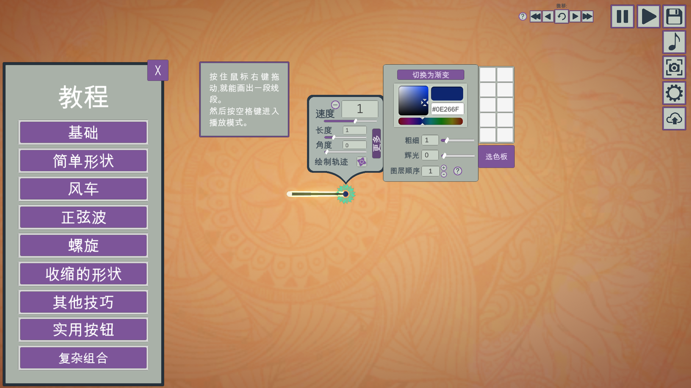
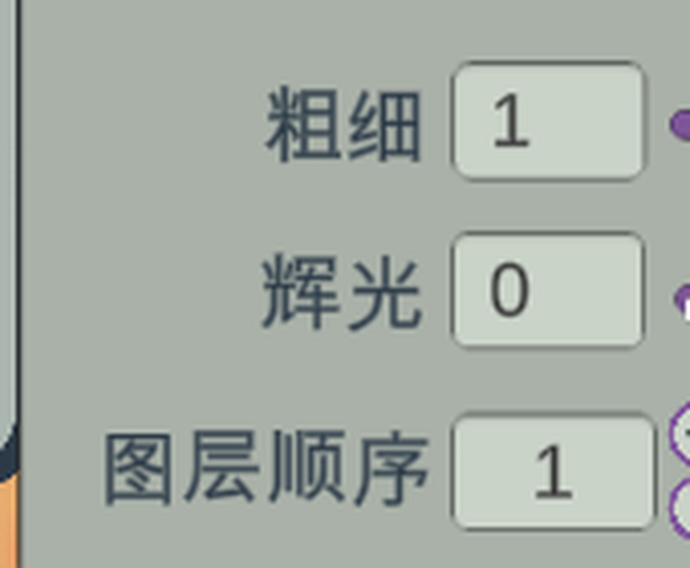

# Zen Trails 简体中文汉化

给 Steam 上的 **Zen Trails** 做的一套完整简体中文汉化。原版只有英文，且游戏用 Unity 内置字库，直接塞中文会变成方块；这里用 **BepInEx + XUnity.AutoTranslator + 中文 SDF 字体 + 手工静态词典** 的方案把界面、教程、设置、社区页全部翻掉，另外附带一个很小的插件修掉中文标签在信息气泡里不对齐的毛病。


## 效果

界面、教程十章的正文、修改面板、设置、存档、社区与上传页都已覆盖：



- **437** 条人工词条（覆盖 440 条原文，含教程整段长文）＋ **56** 条补充词条 ＋ **16** 条正则（`SPEED:`、`PAGE:`、`N OF RECURSIONS` 这类运行时拼出来的字符串）
- 全部为**人工翻译的静态词典**，不依赖任何在线翻译服务，断网也能用，译文稳定不会每次变
- 字体用 Arial Unicode 的 TMP SDF 图集作为**回落字形**，英文仍是原版字体，混排不跳字

## 安装（给玩家）

1. 把压缩包里的所有内容解压到游戏根目录，和 `Zen Trails.exe` 同级（即合并 `BepInEx/`、`winhttp.dll`、`doorstop_config.ini` 等）
2. 正常启动游戏，界面即为中文

想恢复英文：删掉 `winhttp.dll`、`doorstop_config.ini`、`BepInEx/` 三个即可，游戏文件本身没有被修改。

详细说明见随包的 [docs/安装说明.txt](docs/安装说明.txt)。

## 目录结构

```
ZenTrails-CN/
├─ pyproject.toml          Python 依赖声明（用 uv 管理，见下）
├─ uv.lock                 锁定的依赖版本
├─ .python-version         固定 CPython 3.14
├─ plugin/                 BepInEx 插件（C# 源码）
│   ├─ ZenTrailsCN.cs        界面微调插件，随包发布
│   ├─ ZenDump.cs            开发调试插件（运行时 dump UI 树、模拟点击），不随包发布
│   └─ build.ps1             用 csc 编译出 out/ZenTrailsCN.dll
├─ translation/            翻译源文件
│   ├─ ZenTrails_文本清单.csv  从游戏里 dump 出来的 482 条英文原文（编号, 来源, 原文, 译文, 备注）
│   ├─ zh_01..04.txt          人工译文，格式 <编号> TAB <中文>
│   ├─ extra_zh.txt           补充词条（预设名、零散界面词），格式 <英文原文> TAB <中文>
│   └─ font_chars.json        字体 bundle 实际含有的字形，用来校验译文不会出现方块
├─ tools/
│   ├─ paths.py               统一路径约定（仓库内相对定位，游戏目录可覆盖）
│   ├─ package.py             组装 dist/ 并打成发布 zip
│   ├─ build.py               生成 zhuanti.txt + zz_regex.txt（写入游戏目录）
│   ├─ adddict.py             生成 zh_extra.txt（写入游戏目录）
│   ├─ ctl.py                 窗口截图 / 模拟点击与按键，配合调试插件做 UI 验证
│   ├─ measure_rows.py        ／ m_rows.py      逐像素量标签与数值框位置
│   ├─ layout.py              ／ coverage.py    布局导出、词条覆盖率统计
│   └─ explore/               早期一次性脚本（dump 汇编字符串、扫描 TextMeshPro 等），仅存档
├─ docs/
│   ├─ 安装说明.txt            随包发给玩家的说明
│   ├─ 结构笔记.md             面板层级、几何常量、调试插件用法等逆向笔记
│   └─ images/                截图
└─ out/ dist/ dl/ dumps/ shots/ scratch/    构建产物与原始素材（.gitignore，不进仓库）
```

## 它是怎么工作的

### 1. 加载层：BepInEx + XUnity.AutoTranslator

- [BepInEx 5.4.23.6](https://github.com/BepInEx/BepInEx)（`winhttp.dll` doorstop 方式注入，不改游戏文件）
- [XUnity.AutoTranslator 5.6.3.1](https://github.com/bbepis/XUnity.AutoTranslator) 负责在运行时替换 TMP / UGUI 的文本，并让它能在缺字形时切到别的字体
- 词条放在 `BepInEx/Translation/zh-CN/Text/` 下的三个 txt 里，**启动时一次性载入**，所以改词条必须重启游戏

### 2. 字体：中文从哪里来

游戏自带的 TMP 字体只有拉丁字形，所以：

1. 用 Unity 2019 的 TMP 字体包里的 Arial Unicode 生成 SDF 字体资产 `arialuni_sdf_u2019`
2. `AutoTranslatorConfig.ini` 里设 `FallbackFontTextMeshPro=arialuni_sdf_u2019`
3. 这样原文有字形时用原字体，遇到中文才回落到这个 bundle —— 英文排版、字距和原版完全一致

`font_chars.json` 是这个 bundle 里**真实存在**的字形集合，`tools/build.py` 会拿它校验每条译文；缺字形就先在生成阶段报出来，避免游戏里看到方块。中文标点用的全角逗号、括号等在图集里没有，生成时会统一替换成 `,` `(` 之类的半角形式（见 `build.py` 里的 `NORM`）。

### 3. 词典文件

| 文件 | 条数 | 内容 |
|---|---|---|
| `zhuanti.txt` | 437 | 整句与界面词，`英文=中文`，由 `zh_0*.txt` 生成 |
| `zh_extra.txt` | 56 | 调色板 / 预设名等零散词，`英文=中文`，由 `extra_zh.txt` 生成 |
| `zz_regex.txt` | 16 | 运行时拼接的字符串，正则匹配 |

## 界面微调插件 ZenTrailsCN

汉化后线段信息气泡里出现一个小问题：**中文标签比英文长，三行（粗细 / 辉光 / 图层顺序）的数值框被各自的标签顶着，站不到同一列**，看起来参差不齐。



插件做的事：

1. 找到 `InfoPanelsCanvas/SegmentInfoPanel/AestheticsPanel`
2. 把三个数值框（每行标签的子物体）平移到同一列
3. 用 TMP 的 `margin.x` ＋ **等量反向的 `margin.z`** 移动标签字形（只改 `margin.x` 会把标签挤到换行）
4. 全部在**面板局部坐标系**里算，所以能在气泡还缩在 `localScale=0` 的收起状态下就改好 —— 第一次点开就是对齐的，没有"先错位再自动矫正"的过程

日志在 `BepInEx/zen_cn.log`：

```
=== ZenTrailsCN UI 12:22:18 ===
panel found (active, scale 0.000)      ← 面板还没显示就已经找到
p0  box LayerOrder step -31.10
p0  LineThickness glyphs -120.15..-80.88 need 48.16 (box -26.44)
  LineThickness margin -531.9->-222.0 k=0.1554 right -80.88->-32.72
p0  Glow glyphs -79.12..-38.80 need 6.08 (box -26.72)
  Glow margin -531.9->-492.7 k=0.1554 right -38.80->-32.72
```

具体几何与常量见 [docs/结构笔记.md](docs/结构笔记.md)。

## 从源码构建

需要 Windows、装了游戏本体、`.NET Framework 4` 自带的 `csc.exe`（编译插件），以及 [uv](https://docs.astral.sh/uv/)（跑工具脚本）。

**Python 环境**用 uv 管，依赖写在 `pyproject.toml`、版本锁在 `uv.lock`：

```powershell
uv sync            # 建 .venv 并按 uv.lock 装好 Pillow / UnityPy
```

之后所有脚本都通过 `uv run` 执行（不用手动激活虚拟环境，也不依赖系统里的 Python）：

```powershell
# 1) 编译界面微调插件 -> out\ZenTrailsCN.dll
powershell -ExecutionPolicy Bypass -File plugin\build.ps1

# 装进游戏（会覆盖 BepInEx\plugins\ZenTrailsCN.dll，重启生效）
powershell -ExecutionPolicy Bypass -File plugin\build.ps1 -Deploy

# 2) 重新生成词典（直接写入游戏目录的 Translation\zh-CN\Text）
uv run python tools\build.py
uv run python tools\adddict.py
# 之后重启游戏才会重新载入词条
```

依赖分两层：`pillow` 是主依赖（截图、逐像素测量），`unitypy` 放在 dev 组（只在导出 UI 树 / 字体图集这类资源逆向时用到，`uv sync` 默认会装）。

**路径都不写死**：仓库内的目录由 `tools/paths.py` 以该文件所在位置为基准算出来，搬到哪都能跑；游戏安装目录在仓库之外，默认按 Steam 的常见位置拼，装在别的盘时用环境变量覆盖：

```powershell
$env:ZEN_TRAILS_HOME = "D:\Games\Zen Trails"     # 一次设置，之后所有脚本和 build.ps1 都认
```

`plugin\build.ps1` 也支持 `-Game "D:\Games\Zen Trails"` 显式指定。

### 打发布包

```powershell
uv run python tools\package.py                   # 重新组装 dist\zen-trails-zh\ 并打包
uv run python tools\package.py --verify          # 只跟现有 zip 比对内容，不覆盖
uv run python tools\package.py --rebuild-plugin  # 先重新编译插件再打
```

组装规则：运行时文件（`BepInEx/core`、`BepInEx/plugins` 里的 XUnity 两个插件、`winhttp.dll`、`doorstop_config.ini`、字体 bundle `arialuni_sdf_u2019`、以及 AutoTranslator 的配置和三个占位 txt）从游戏目录取；三个词典由本仓库的 `translation/` **现生成**（不是复制游戏里的旧文件）；插件来自 `out\ZenTrailsCN.dll`；说明文档来自 `docs\安装说明.txt`。

产物是 `dist\ZenTrails-CN-v<版本>.zip`（如 `dist\ZenTrails-CN-v0.1.1.zip`），约 28.6 MB / 64 个条目（`dist/` 不入库）。`--verify` 会按 CRC 逐条目比对，正常结果是「条目数相同、只有 `BepInEx/plugins/ZenTrailsCN.dll` 不同」——因为重新编译的 DLL 内嵌 MVID/时间戳不一样，代码本身没变。

改译文的流程：`translation/zh_0*.txt` 里按 `<编号> TAB <中文>` 改，编号对应 `ZenTrails_文本清单.csv` 第一列；零散词条在 `extra_zh.txt` 里按 `<英文> TAB <中文>` 加。`build.py` 会打印缺字形、缺译文、带多余 `=` 的行。

## 已知问题

- **少数长标签会换行**：面板宽度是按英文字宽设计的，如「从色板随机取一个颜色」「轨迹宽度」在窄栏里会折成两行。属于原版布局限制，没有强行压缩字号。
- **社区作品标题不翻译**：玩家上传的作品名是外部数据，保持原样。
- **未命中词条**：词典没覆盖的新文本会退回英文（或由 AutoTranslator 按配置尝试机翻）。
- 只针对当前 Steam 版本的 Unity 2019.1.8f1 / TMP 1.4.0；游戏大版本更新后插件的路径匹配可能需要跟着调整（`ZenTrailsCN.cs` 里的 `Scan()` 按名字找面板，找不到就静默跳过，不会影响游戏启动）。

## 说明

- 本仓库只包含插件源码、翻译文本与工具脚本，**不含任何游戏本体文件**；字体 bundle 来自 Unity 官方的 TMP 字体资源包。
- 汉化文本可自由取用；BepInEx、XUnity.AutoTranslator 遵循各自的许可证（LGPL-2.1 / MIT）。
